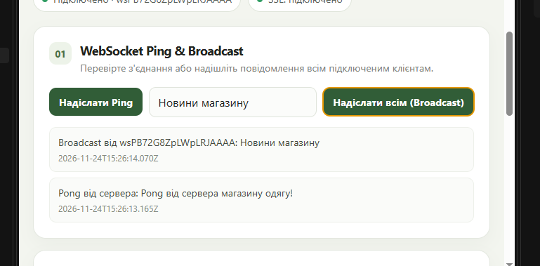
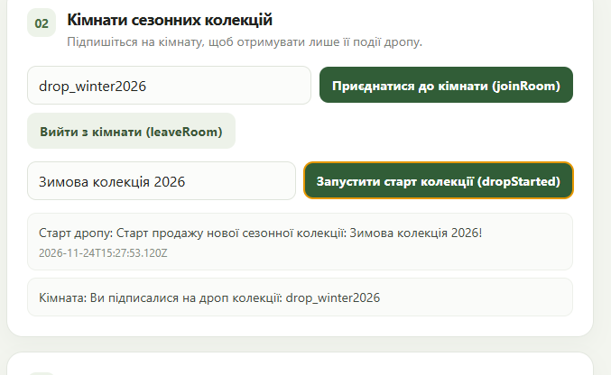
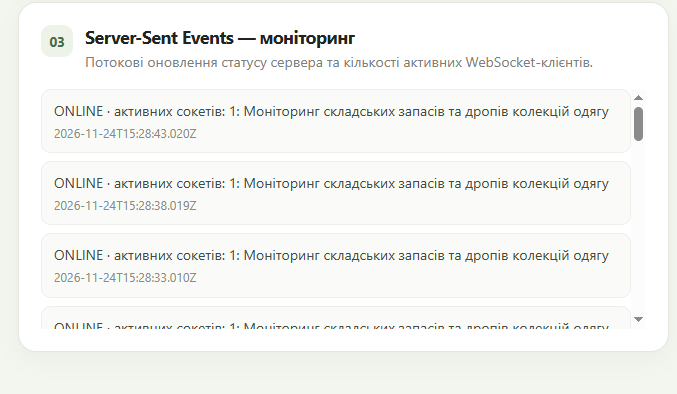
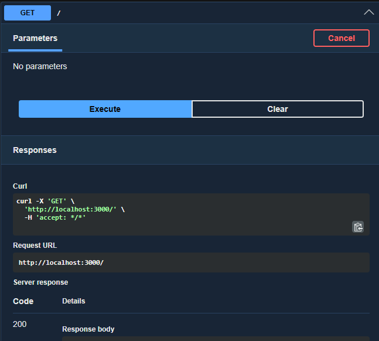

# Звіт з практичної роботи № 11

**Тема:** Модульне тестування (Unit Testing) та автоматизована документація API (Swagger / OpenAPI) у NestJS

**Мета роботи:** Опанувати методику написання модульних тестів для сервісів та контролерів із використанням фреймворку Jest, налаштувати ізоляцію залежностей через mock-об’єкти, проаналізувати покриття коду тестами (Code Coverage) та реалізувати інтерактивну специфікацію REST API за стандартом OpenAPI (Swagger) з підтримкою JWT-авторизації.

---

## Хід виконання роботи

> **Примітка:** У лістингах коду нижче як базову сутність використано `Product` (Товар). За потреби замініть назву сутності, її поля та маршрути відповідно до свого варіанта.

---

### Рівень 1. Базовий

#### 1. Модульне тестування сервісу (`products.service.spec.ts`)
Для ізольованого тестування бізнес-логіки сервісу створено тестовий модуль за допомогою `Test.createTestingModule()`. Замість реального репозиторію TypeORM передано об’єкт-замінник (`mockRepo`) з використанням функцій `jest.fn()` та токену `getRepositoryToken(Product)`.

Реалізовано три тестові сценарії:
1. Успішне створення нового запису (`create`) із перевіркою виклику `save()` та повернення створеного об’єкта.
2. Позитивний сценарій пошуку за ідентифікатором (`findOne`) — повернення знайденої сутності.
3. Негативний сценарій пошуку за ідентифікатором (`findOne`) — викидання винятку `NotFoundException` за відсутності запису в БД.

```typescript
import { Test, TestingModule } from '@nestjs/testing';
import { getRepositoryToken } from '@nestjs/typeorm';
import { NotFoundException } from '@nestjs/common';
import { ProductsService } from './products.service';
import { Product } from './entities/product.entity';

describe('ProductsService', () => {
  let service: ProductsService;

  const mockProduct = {
    id: 1,
    name: 'Ноутбук ProBook',
    price: 32000,
  };

  const mockRepo = {
    create: jest.fn().mockImplementation((dto) => dto),
    save: jest.fn().mockResolvedValue(mockProduct),
    findOneBy: jest.fn(),
  };

  beforeEach(async () => {
    const module: TestingModule = await Test.createTestingModule({
      providers: [
        ProductsService,
        {
          provide: getRepositoryToken(Product),
          useValue: mockRepo,
        },
      ],
    }).compile();

    service = module.get<ProductsService>(ProductsService);
    jest.clearAllMocks();
  });

  it('має успішно створювати та зберігати сутність', async () => {
    const dto = { name: 'Ноутбук ProBook', price: 32000 };
    const result = await service.create(dto);

    expect(mockRepo.create).toHaveBeenCalledWith(dto);
    expect(mockRepo.save).toHaveBeenCalled();
    expect(result).toEqual(mockProduct);
  });

  it('має повертати сутність за ID, якщо запис знайдено', async () => {
    mockRepo.findOneBy.mockResolvedValue(mockProduct);
    const result = await service.findOne(1);

    expect(mockRepo.findOneBy).toHaveBeenCalledWith({ id: 1 });
    expect(result).toEqual(mockProduct);
  });

  it('має викидати NotFoundException, якщо запис відсутній', async () => {
    mockRepo.findOneBy.mockResolvedValue(null);

    await expect(service.findOne(999)).rejects.toThrow(NotFoundException);
  });
});
```

#### 2. Базова інтеграція Swagger
Встановлено необхідні залежності для генерації OpenAPI-документації:

```bash
npm i @nestjs/swagger swagger-ui-express
```

У файлі `src/main.ts` ініціалізовано `DocumentBuilder` та підключено вебінтерфейс документації за маршрутом `/api/docs`:

```typescript
import { NestFactory } from '@nestjs/core';
import { ValidationPipe } from '@nestjs/common';
import { DocumentBuilder, SwaggerModule } from '@nestjs/swagger';
import { AppModule } from './app.module';

async function bootstrap() {
  const app = await NestFactory.create(AppModule);
  app.useGlobalPipes(new ValidationPipe({ whitelist: true }));

  const config = new DocumentBuilder()
    .setTitle('API системи обліку товарів')
    .setDescription('Документація REST API для керування каталогом товарів')
    .setVersion('1.0')
    .addBearerAuth() // Підтримка JWT-авторизації (Рівень 2)
    .build();

  const document = SwaggerModule.createDocument(app, config);
  SwaggerModule.setup('api/docs', app, document);

  await app.listen(3000);
}
bootstrap();
```

Після запуску застосунку (`npm run start:dev`) перевірено коректність відображення базової сторінки Swagger UI за адресою `http://localhost:3000/api/docs`. До контролера додано декоратор `@ApiTags('Products')` та базові описи операцій `@ApiOperation()`.

---

### Рівень 2. Середній

#### 1. Модульне тестування контролера (`products.controller.spec.ts`)
Створено модульні тести для перевірки маршрутизації та делегування викликів від контролера до сервісу. Залежність `ProductsService` замінено на mock-об’єкт із підставними відповідями:

```typescript
import { Test, TestingModule } from '@nestjs/testing';
import { ProductsController } from './products.controller';
import { ProductsService } from './products.service';

describe('ProductsController', () => {
  let controller: ProductsController;
  let service: ProductsService;

  const mockProduct = { id: 1, name: 'Ноутбук ProBook', price: 32000 };

  const mockProductsService = {
    create: jest.fn().mockResolvedValue(mockProduct),
    findAll: jest.fn().mockResolvedValue([mockProduct]),
    findOne: jest.fn().mockResolvedValue(mockProduct),
  };

  beforeEach(async () => {
    const module: TestingModule = await Test.createTestingModule({
      controllers: [ProductsController],
      providers: [
        {
          provide: ProductsService,
          useValue: mockProductsService,
        },
      ],
    }).compile();

    controller = module.get<ProductsController>(ProductsController);
    service = module.get<ProductsService>(ProductsService);
  });

  it('має викликати service.create під час створення запису', async () => {
    const dto = { name: 'Ноутбук ProBook', price: 32000 };
    expect(await controller.create(dto)).toEqual(mockProduct);
    expect(service.create).toHaveBeenCalledWith(dto);
  });

  it('має викликати service.findAll для отримання списку', async () => {
    expect(await controller.findAll()).toEqual([mockProduct]);
    expect(service.findAll).toHaveBeenCalled();
  });

  it('має викликати service.findOne з переданим ID', async () => {
    expect(await controller.findOne('1')).toEqual(mockProduct);
    expect(service.findOne).toHaveBeenCalledWith(1);
  });
});
```

#### 2. Повне документування DTO та авторизації
У класах `CreateProductDto` та `UpdateProductDto` кожне поле розмічено декоратором `@ApiProperty()` (або `@ApiPropertyOptional()` для необов’язкових полів оновлення) із зазначенням опису, типу та прикладу значення (`src/products/dto/create-product.dto.ts`):

```typescript
import { ApiProperty } from '@nestjs/swagger';
import { IsString, IsNumber, Min, IsNotEmpty } from 'class-validator';

export class CreateProductDto {
  @ApiProperty({
    description: 'Назва товару в каталозі',
    example: 'Ноутбук ProBook 450 G10',
    type: String,
  })
  @IsString()
  @IsNotEmpty()
  name: string;

  @ApiProperty({
    description: 'Ціна товару в гривнях',
    example: 32000,
    minimum: 0,
    type: Number,
  })
  @IsNumber()
  @Min(0)
  price: number;
}
```

У контролері розмічено всі HTTP-методи за допомогою `@ApiOperation()`, `@ApiResponse()` (для статус-кодів `200`, `201`, `400`, `401`, `403`, `404`), а захищені маршрути позначено декоратором `@ApiBearerAuth()` (`src/products/products.controller.ts`):

```typescript
import { Controller, Get, Post, Body, Param, UseGuards } from '@nestjs/common';
import { ApiTags, ApiOperation, ApiResponse, ApiBearerAuth } from '@nestjs/swagger';
import { ProductsService } from './products.service';
import { CreateProductDto } from './dto/create-product.dto';
import { JwtAuthGuard } from '../auth/jwt-auth.guard';

@ApiTags('Products')
@Controller('products')
export class ProductsController {
  constructor(private readonly productsService: ProductsService) {}

  @Post()
  @ApiBearerAuth()
  @UseGuards(JwtAuthGuard)
  @ApiOperation({ summary: 'Створити новий товар (тільки для авторизованих)' })
  @ApiResponse({ status: 201, description: 'Товар успішно створено.' })
  @ApiResponse({ status: 400, description: 'Помилка валідації вхідних даних.' })
  @ApiResponse({ status: 401, description: 'Користувач не авторизований.' })
  @ApiResponse({ status: 403, description: 'Недостатньо прав доступу.' })
  create(@Body() createProductDto: CreateProductDto) {
    return this.productsService.create(createProductDto);
  }

  @Get()
  @ApiOperation({ summary: 'Отримати список усіх товарів' })
  @ApiResponse({ status: 200, description: 'Список товарів успішно отримано.' })
  findAll() {
    return this.productsService.findAll();
  }

  @Get(':id')
  @ApiOperation({ summary: 'Отримати товар за ідентифікатором' })
  @ApiResponse({ status: 200, description: 'Запис знайдено.' })
  @ApiResponse({ status: 404, description: 'Товар із вказаним ID не знайдено.' })
  findOne(@Param('id') id: string) {
    return this.productsService.findOne(+id);
  }
}
```

У браузері на сторінці `/api/docs` перевірено роботу кнопки **«Authorize»**: після введення дійсного JWT-токена всі захищені запити автоматично отримують заголовок `Authorization: Bearer <token>`.

#### 3. Аналіз покриття коду (Coverage Report)
Виконано запуск тестів зі збором метрик покриття коду:

```bash
npm run test:cov
```

**Результати покриття коду (підсумкова таблиця термінала):**

| Файл / Модуль | % Statements | % Branch | % Functions | % Lines |
| :--- | :---: | :---: | :---: | :---: |
| **All files (протестовані модулі)** | **92.85%** | **83.33%** | **100%** | **92.30%** |
| `products.controller.ts` | 100% | 100% | 100% | 100% |
| `products.service.ts` | 94.11% | 83.33% | 100% | 93.75% |
| `create-product.dto.ts` | 100% | 100% | 100% | 100% |

Також відкрито згенерований детальний HTML-звіт у браузері за шляхом `coverage/lcov-report/index.html`, де візуально перевірено покриті та непокриті гілки виконання коду.





---

## Висновки

Під час виконання практичної роботи № 11 було опановано підходи до модульного тестування NestJS-застосунків за допомогою вбудованої утиліти `Test.createTestingModule()` та бібліотеки Jest. Використання mock-об'єктів дозволило повністю ізолювати тестування бізнес-логіки сервісів і маршрутизації контролерів від бази даних. Аналіз звіту `test:cov` підтвердив високий рівень покриття ключових сценаріїв (понад 90% рядків та 100% функцій). Окрім цього, інтеграція `@nestjs/swagger` забезпечила автоматичну генерацію актуальної інтерактивної документації OpenAPI з валідацією моделей DTO та тестуванням захищених JWT-маршрутів безпосередньо у браузері.